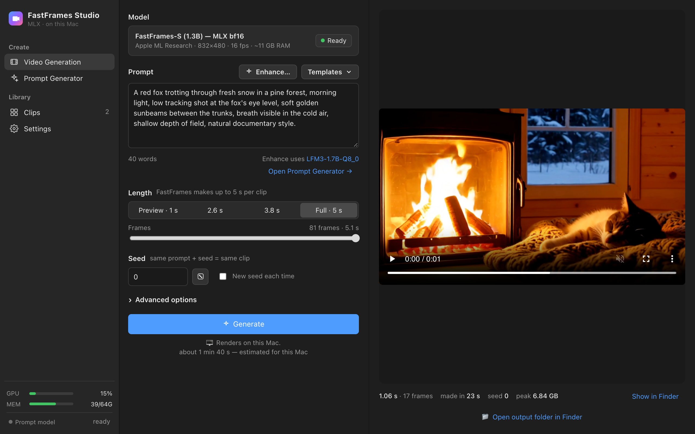
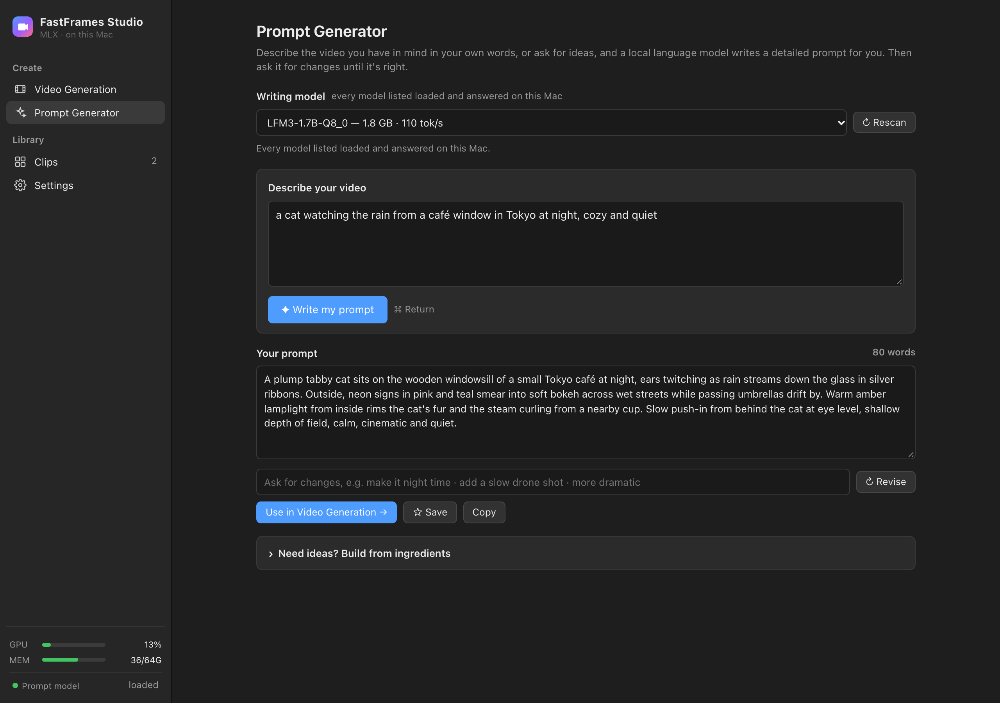
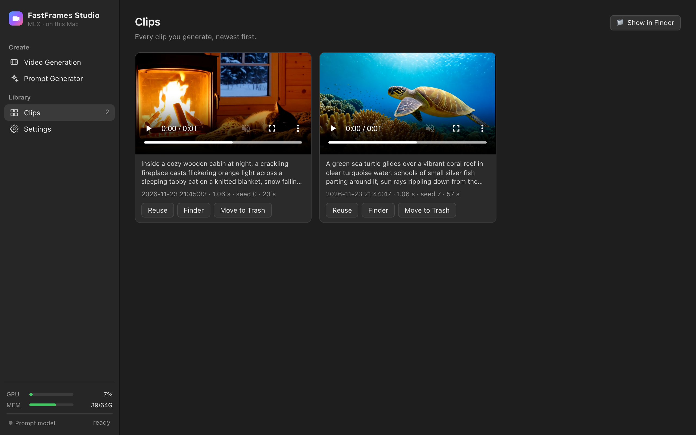
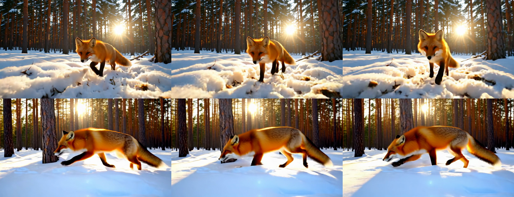

<div align="center">


# FastFrames Studio

**Type a sentence, get a 5-second video — made entirely on your Mac.**

A polished, native-feeling studio for Apple's [FastFrames](https://apple-aiml-research.github.io/ml-fastframes/)
text-to-video model on Apple silicon, with a built-in prompt writer powered by whatever local
language models you already have.


</div>

---

<p align="center"></p>

## Why

FastFrames is Apple ML Research's fast text-to-video model — 832×480, 16 fps, built to respond in
real time on big GPUs. Community MLX ports make it run on a Mac, but only from the command line.
FastFrames Studio wraps it in a clean, dark, Mac-style app so you can **write, generate, review and
iterate** without touching a terminal — and helps you write the long, specific prompts the model
loves.

On an M1 Max a full 5-second clip takes about **1½ minutes**, and a 1-second preview about
**20 seconds** — minutes, not the 15–30 minutes typical of larger local video models.

## Features

### 🎬 Video Generation
- **Two models** — **FastFrames-S** (1.3B) for quick drafts, or **FastFrames-L** (14B, 8-bit) for clearly sharper, more realistic video on Macs with enough memory. The app shows how much memory the chosen length needs and warns you if it won't fit right now.
- **Prompt box with Enhance** — turn *"a dog surfing at sunset"* into a rich, cinematic paragraph in about a second, with the writing model picker right there.
- **Templates** — ten ready-made prompts to start from.
- **Length presets** — 1 s preview, 2.6 s, 3.8 s or the full 5 s, plus a frame slider.
- **Seeds** — same prompt + seed gives the same clip; roll a new seed or auto-randomize every run.
- **Live progress** — frame-by-frame progress bar, elapsed time and an estimate that learns your Mac's speed. Cancel any time.
- **Instant preview** — the clip plays as soon as it's done, with its timing, seed and peak memory.

<p align="center"></p>

### ✨ Prompt Generator
- **Describe it your way** — type what you want in plain words (*"a cat watching the rain from a café window in Tokyo at night"*), or ask a question (*"what would look amazing in a 5-second clip about autumn?"*), and a local language model writes a detailed, cinematic prompt. ⌘ Return to write.
- **Ask for changes** — *"make it daytime"*, *"add a slow drone shot"*, *"more dramatic"* — and it revises the prompt, keeping everything else. One-click undo.
- **Pick the writing model** — a dropdown (on this page and next to the Video prompt) lists every chat model on your Mac that actually works:
  - GGUF files in LM Studio, Hugging Face and your own folders are **test-loaded once in the background** with llama.cpp (smallest first); only models that load and answer are shown, with their measured speed.
  - Models from **MLX-Serve, LM Studio and Ollama** appear automatically while those apps are running.
  - Image, audio, embedding and draft-model files are filtered out, and so are models too large to run next to the video model.
  - Small models such as LFM3-1.7B write a full prompt in about a second.
- **Need ideas?** — optional ingredient pickers (subject, action, setting, lighting, camera, style, mood) with 🎲 dice: build a prompt instantly, have the model write from them, or **Surprise me**.
- **Saved prompts** — keep favourites and send any prompt straight to Video Generation.

<p align="center"></p>

### 🗂 Clips library
- Every clip with its prompt, seed, length and render time, newest first.
- Hover to play, **Reuse** to load the exact prompt and seed, reveal in Finder, or move to Trash.

### 🖥 A real Mac app
- **FastFrames Studio.app** has its own window, Dock icon and menu bar (⌘1–3 switch pages, ⌘, opens Settings).
- It starts its local server when you open it, and **⌘Q stops everything** and frees the memory (it warns you if a video is still generating).
- Live **GPU and memory meters** in the sidebar.
- Runs on `127.0.0.1` only — nothing leaves your Mac.

## Requirements

| | |
|---|---|
| Mac | Apple silicon (M1 or newer), macOS 14+ |
| Memory | 16 GB minimum, 32 GB+ recommended (FastFrames peaks at ~11 GB) |
| Disk | ~16 GB for the model (downloaded on first use) |
| Software | Python 3.10+, `ffmpeg` (`brew install ffmpeg`), Xcode Command Line Tools to build the app (`xcode-select --install`) |
| Prompt writer (optional) | a recent llama.cpp `llama-server` (`brew install llama.cpp`) plus any small GGUF chat model — e.g. LiquidAI LFM3-1.7B — or a running MLX-Serve, LM Studio or Ollama |

## Install

```bash
git clone https://github.com/simplyakil/fastframes-studio.git
cd fastframes-studio
python3 -m venv .venv && .venv/bin/pip install -r requirements.txt
./tools/make_app.sh                  # builds ~/Applications/FastFrames Studio.app (native app)
open ~/Applications/"FastFrames Studio.app"
```

The first video downloads the [MLX port](https://huggingface.co/mlx-community/FastFrames-S-bf16-mlx)
(~15 GB) into your Hugging Face cache. Prefer the terminal? Run `./launch.sh`, or
`.venv/bin/python app.py` and open <http://127.0.0.1:7870>.

## FastFrames-L (optional, best quality)

<p align="center"></p>
<p align="center"><sub>Same prompt and seed. Top: FastFrames-S, 23 s. Bottom: FastFrames-L 8-bit, 3 min 22 s (M1 Max, 64 GB).</sub></p>

FastFrames-L runs through the community [MLX port](https://huggingface.co/mlx-community/FastFrames-L-bf16-mlx)
with its 8-bit option, in its own process, so its memory is returned to macOS as soon as a clip is done.

| clip length | peak memory (8-bit) | M1 Max 64 GB |
|---|---|---|
| 1 s (5 latent frames) | ~28 GB | 3 min 22 s |
| 2.6 s (11) | ~36 GB | — |
| 5 s (21) | ~48 GB | needs ~96 GB Mac or a mostly idle 64 GB one |

Setup (about 31 GB of downloads plus a 15 GB 8-bit file built once):

```bash
hf download mlx-community/FastFrames-L-bf16-mlx --exclude "samples/*" --local-dir ~/Models/FastFrames-L-mlx
```

Then set `l_port_dir` in `config.json` to that folder. Leave `l_weights_dir` empty and the first L
clip downloads Apple's weights (checked against Apple's SHA-256 sums) and builds the 8-bit file; or
point it at a folder holding `dit`, `kv_refiner`, `pixel_decoder` and `umt5_xxl` `.safetensors`
(the umT5 file can be the one from FastFrames-S).

## Configuration

Copy `config.example.json` to `config.json` (it's git-ignored) and edit what you need:

| key | what it does |
|---|---|
| `model_dir` | a local FastFrames-S-bf16-mlx folder (`run.py` + `*.safetensors`); empty = download automatically |
| `out_dir` | where clips are saved (default `~/Movies/FastFrames Studio`) |
| `llama_server` | path to `llama-server`; empty = auto-detect (PATH, Homebrew, `~/.unsloth/llama.cpp`) |
| `model_search_dirs` | folders scanned for GGUF chat models |
| `keep_llm_loaded` | keep the prompt model in memory between prompts |
| `l_port_dir` | FastFrames-L MLX port folder (holds `ffmlx/run.py`); empty = L is off |
| `l_weights_dir` | folder with the four L `.safetensors` files; empty = the port downloads them |
| `l_cache_dir` | where the 8-bit L file and text embeddings go; empty = `~/.cache/fastframes-mlx` |

Quitting the app (⌘Q, or **Settings → Quit**) stops the server and frees its memory. If you started
the server with `./launch.sh` instead, it keeps running in the background until you quit it from Settings.

## Good to know

- FastFrames makes video from **text only** — there's no image input.
- Long, specific prompts (subject, motion, setting, light, camera, style) follow your words much
  more closely than short ones. That's what the Prompt Generator is for.
- Fine detail, faces and hands are soft at 480p; landscapes, animals and moody scenes shine.

## How it works

A small Python server (`app.py`, standard library only) runs the MLX port's pipeline in a
background thread — umT5 text encoder → causal Wan2.1-1.3B DiT with FastFrames' KV refinement →
FastFrames' lightweight pixel decoder → ffmpeg — and serves a single-page UI (`index.html`, no
build step). `prompt_models.py` finds language models by reading GGUF headers and checking each
architecture against your `llama-server` build before test-loading it.

## Credits & licenses

- **FastFrames** — Gene Chou, Guandao Yang, Fujun Luan, Lars Mescheder, Wei Dong, Stephan R. Richter
  and Vladlen Koltun, Apple ([paper](https://arxiv.org/abs/2611.23226)). Weights are under the
  **Apple Machine Learning Research Model License — non-commercial research use only.**
- **MLX port** — [mlx-community/FastFrames-S-bf16-mlx](https://huggingface.co/mlx-community/FastFrames-S-bf16-mlx),
  an unofficial community port, built on [Wan2.1](https://github.com/Wan-Video/Wan2.1) and
  [Causal Forcing++](https://github.com/thu-ml/Causal-Forcing).
- **This app** — MIT licensed (see [LICENSE](LICENSE)). It downloads and runs the model files above
  but does not include them. Not affiliated with or endorsed by Apple.
